  

  <i>🏮 "I'm looking for an honest dataset." 🏮</i>

 

<h3 align="center">🛠️ Tools in My Barrel</h3>

  <!-- Languages & Core ML -->
  
  
  
  
  
  
  
   
  <!-- Data Science, NLP & Frameworks -->
  
  
  
  
  
  
  
   
  <!-- MLOps & Infrastructure -->
  
  
  
  
  

 

<h3 align="center">🏮 Find Me (I'm Not in the Barrel)</h3>

  
  
  

